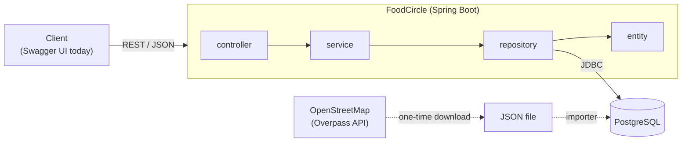

# FoodCircle

A backend for finding cafes and restaurants **near you in Hyderabad** and seeing what **the people you follow** thought of them: their food and ambience ratings, their review text and **which dishes they tried**.

It is a learning project built to practise two classic system-design problems on a real stack, and to be able to explain every decision:

| Feature | System-design problem |
|---|---|
| "Places near me" | **Proximity service** ("design Yelp"): a geohash implemented by hand, neighbour cells, exact distance filtering |
| Feed of reviews from people I follow | **News feed**: fan-out on read, cursor pagination, why bloggers with many followers are a problem |

Java 21 · Spring Boot 4.1 · PostgreSQL 18 · Spring Data JPA (Hibernate) · Gradle · JUnit 5 · k6 · springdoc-openapi

## What it does

- **Nearby search** - `GET /api/places/nearby?lat=&lng=&radiusKm=` returns the open places within a radius, nearest first, with the distance of each.
- **Reviews** - food and ambience ratings (1-5, each optional, at least one required), text, and the dishes tried. The overall rating is the average of the ratings given.
- **Social graph** - follow and unfollow users; follower and following lists with counts.
- **Feed** - reviews from the people you follow, newest first, with cursor pagination. Your own reviews and "people I follow who reviewed this place" are separate endpoints.
- **Errors** are RFC 9457 problem documents (`application/problem+json`).
- **Swagger UI** at `/swagger-ui/index.html`.

## Architecture

One Spring Boot application (a modular monolith). No microservices, no message queue: the interesting parts are the data model, the indexes and the algorithms.



Package-by-layer under `com.vkarun.foodcircle`: `controller/` (HTTP only), `service/` (business logic), `repository/` (Spring Data), `entity/` (JPA), `dto/` (request/response records, entities are never returned), `geo/` (pure geohash and distance code with no Spring), `common/` (errors, cursor, OpenAPI config).

### Data model

| Table | Notes |
|---|---|
| `users` | unique `username` |
| `follows` | unique `(follower_id, followee_id)`, check `follower_id <> followee_id`, index on `followee_id` |
| `places` | unique `(osm_type, osm_id)` so the import is re-runnable; `geohash` (8 characters, `COLLATE "C"`) with an index; `closed_at` marks a closed place instead of deleting it |
| `reviews` | check: each rating 1-5 and at least one given; indexes `(user_id, created_at desc, id desc)` and `(place_id, created_at desc, id desc)` |
| `review_dishes` | free-text dish names with an optional liked flag |

The schema is generated by Hibernate from the entities (`ddl-auto=update`), including the constraints and indexes. That is a deliberate simplification for a one-person project; a migration tool would replace it before real data or a team.

## Design: nearby search with a geohash

A normal index sorts by one column, but "within 2 km" is a two-dimensional question. A **geohash** turns a (latitude, longitude) pair into one string by repeatedly halving the ranges, so places that share a prefix are in the same rectangle and "nearby" becomes an ordinary index range scan.

```
(lat, lng, radius) -> pick the geohash length from the radius -> the user's cell + its 8 neighbours
   -> one indexed range query per cell (coarse filter)  -> haversine distance on those rows (exact filter) -> nearest first
```

- **Encoder, decoder and neighbours are written by hand** (`geo/Geohash`), and tested against published values from the Wikipedia article on Geohash.
- **8 characters are stored** per place; the search uses a shorter prefix chosen so that a cell is at least as large as the radius (otherwise the 3x3 block would not cover the search circle). At Hyderabad's latitude (17.4 N) the cells are, for lengths 4, 5 and 6: 19.55 x 37.30 km, 4.89 x 4.66 km and 0.61 x 1.17 km.
- **Why the 8 neighbours:** two points a few metres apart can sit on opposite sides of a cell border and share no prefix.
- **Why a range query and not `LIKE 'prefix%'`:** with a bound parameter PostgreSQL can switch to a generic plan that cannot use the index for `LIKE`; `geohash >= 'abc' and geohash < 'abc{'` always can. The column is `COLLATE "C"` because the database's default collation would not let a normal index serve prefix searches. Both were checked with `EXPLAIN`.
- **Correctness:** the geohash search returns exactly the same places as a brute-force scan (an integration test over 400 random places and 7 searches, plus 6 live queries compared against a brute-force calculation on the real data).
- **Radius limit:** 15 km. Above about 19.5 km the geohash length would fall to 3, whose cells are about 150 km across, so the index would prune nothing.

### Measured: geohash vs scanning every place

Load test with [k6](https://k6.io) (`load-test/nearby.js`), all on one laptop (Intel i5-1135G7, 16 GB) with the app, PostgreSQL and k6 competing for the same CPU. Each request searches from a random point in central Hyderabad. 30 s measured after a warm-up. These are latencies under saturation, not service times, and each row is a single run unless stated.

**Real data - 1,577 places from OpenStreetMap, 50 virtual users, radius 2 km (two runs):**

| Run | Search | Requests/s | Avg ms | p95 ms |
|---|---|---|---|---|
| 1 | scan every place | 472 | 93 | 273 |
| 1 | **geohash** | **1,114** | **37** | **112** |
| 2 | scan every place | 439 | 106 | 266 |
| 2 | **geohash** | **1,022** | **42** | **138** |

About 2.3x the throughput even on a table this small.

**Larger table - 100,000 synthetic places spread uniformly over the same area, 10 virtual users, 30 s warm-up:**

| Radius | Search | Requests/s | Avg ms | p95 ms | Places returned (avg) |
|---|---|---|---|---|---|
| 0.5 km | scan every place | 3.8 | 2,591 | 3,574 | 43 |
| 0.5 km | **geohash** | **787** | **10.6** | **19.8** | 42 |
| 2 km | scan every place | 6.1 | 1,595 | 1,973 | 670 |
| 2 km | **geohash** | **75.7** | **118** | **182** | 671 |
| 10 km | scan every place | 5.4 | 1,633 | 1,968 | 16,455 |
| 10 km | geohash | 5.9 | 1,433 | 1,780 | 16,589 |

The 0.5 km rows come from one session and the 2 km and 10 km rows from a later one (30 s warm-up and 30 s measured in both), so compare within a radius, not across them. The scan at 2 km was also measured earlier at 4.7 requests/s (avg 2,089 ms), so the scan's number moves by about a quarter between runs; the geohash gap (12x at 2 km) is far larger than that.

The synthetic places are generated data, not real venues. The scan's cost grows with the table (it loads every row on every request); the geohash search's cost grows with the number of places near the user. That is why the advantage shrinks as the radius grows: about 200x at 0.5 km, about 12x at 2 km, and about 1.1x at 10 km. At 10 km the geohash length drops to 4, one 3x3 block covers the whole test area, and each response carries about 16,500 places, so the index prunes almost nothing and the time goes into filtering and serialising the answer. This is why the maximum radius is capped at 15 km.

The scan exists only as an endpoint, `GET /api/places/nearby-naive`, so the two can be compared; it is not meant for normal use.

## Design: the feed

The feed for a user is "all reviews written by people I follow, newest first".

- **Fan-out on read.** The query runs when the feed is opened: a join of `follows` and `reviews` using the `(user_id, created_at desc, id desc)` index. Writes stay cheap (one row). The alternative, fan-out on write, copies each new review into every follower's pre-built feed: reads become trivial, but a blogger with 100,000 followers makes one post cost 100,000 writes (the *celebrity problem*). Real systems use a hybrid; this project implements the simple version and documents the trade-off.
- **Cursor pagination on `(created_at, id)`.** `OFFSET n` makes the database read and discard `n` rows and shifts the list whenever a new review arrives. A cursor says "older than this review", starts where the index says, and is not disturbed by new posts. `id` breaks ties between equal timestamps. The cursor is an opaque URL-safe string, and the query fetches `limit + 1` rows to know whether a next page exists.
- **Measured with `EXPLAIN (ANALYZE, BUFFERS)`** on synthetic data in a rolled-back transaction (PostgreSQL 18, local laptop, one execution per query, warm cache - a plan check, not a benchmark): 2,000 users, 100,000 reviews, one user following 100 users (5,000 feed reviews).

  | Query | Index entries read | Time |
  |---|---|---|
  | first page | 5,051 | 2.2 ms |
  | page deep in the feed, by cursor | 503 | 0.47 ms |
  | the same depth by `OFFSET` | 5,051 + a sort of 4,521 rows | 2.7 ms |

  The honest reading: the first page reads the user's whole feed set to return 21 items, so the cost grows with *people followed x their reviews*, not with the page size. Cursors make deep pages cheaper but not the first one. The next steps would be a per-followee limited merge, caching the first page, then pre-computed feeds.

## Getting started

**Prerequisites:** JDK 21, PostgreSQL (developed on 18), and optionally k6.

**1. Create the database** (as a PostgreSQL superuser):

```sql
CREATE ROLE foodcircle_app LOGIN PASSWORD '<choose a password>';
CREATE DATABASE foodcircle      OWNER foodcircle_app;
CREATE DATABASE foodcircle_test OWNER foodcircle_app;   -- used by the tests
```

**2. Give the app the password through the environment** (it is never stored in a file):

```powershell
$env:FOODCIRCLE_DB_PASSWORD = '<the password>'      # PowerShell
# export FOODCIRCLE_DB_PASSWORD='<the password>'    # bash
```

**3. Get the place data.** It is not in the repository. Download Hyderabad's cafes, restaurants and fast-food places from OpenStreetMap's [Overpass API](https://overpass-api.de/) and save the result as `data/osm/hyderabad-food-places.json`. The measurements here used the filter `amenity` = `restaurant`, `cafe` or `fast_food` inside the bounding box 17.20-17.60 N, 78.25-78.65 E, with the centre point for building outlines. A query of that shape:

```
[out:json][timeout:90];
nwr["amenity"~"^(restaurant|cafe|fast_food)$"](17.20,78.25,17.60,78.65);
out center;
```

The exact request text of the original download was not saved, and this query has not been re-run against the live service (the public Overpass server answered with an error when it was tried), so treat it as a starting point. It is a public, shared service: send an identifying `User-Agent` header and retry later if it is busy. OpenStreetMap data changes over time, so counts will differ from those quoted in these notes (1,774 elements, 1,577 of them named, data of 22 October 2026).

**4. Import it** (re-running is safe: places are matched on their OpenStreetMap type and id):

```powershell
.\gradlew.bat bootRun --args="--import-osm=data/osm/hyderabad-food-places.json --spring.main.web-application-type=none"
```

**5. Run the app** and open Swagger UI:

```powershell
.\gradlew.bat bootRun
# http://localhost:8080/swagger-ui/index.html
```

Hibernate creates the tables on first start. Endpoints that need to know who you are take an `X-User-Id` header with a user id (create one with `POST /api/users`). **This is a temporary stand-in for authentication and is not secure.**

**Tests:**

```powershell
.\gradlew.bat test      # uses the foodcircle_test database; it creates and drops its tables each run
```

**Load test** (start the app first):

```powershell
k6 run -e ENDPOINT=nearby       load-test/nearby.js
k6 run -e ENDPOINT=nearby-naive load-test/nearby.js
# options: -e VUS=50 -e DURATION=30s -e RADIUS_KM=2 -e BASE_URL=http://localhost:8080
```

## API

| Method and path | Purpose |
|---|---|
| `GET /api/places/nearby?lat=&lng=&radiusKm=` | open places within the radius (default 2, max 15 km), nearest first |
| `GET /api/places/{id}` | one place |
| `POST /api/users` · `GET /api/users/{id}` | create a user · profile with follower and following counts |
| `POST` / `DELETE /api/users/{id}/follow` | follow / unfollow (both idempotent; following yourself is a 400) |
| `GET /api/users/{id}/followers` · `/following` | the two lists |
| `POST /api/places/{id}/reviews` · `GET` | write a review with dishes · newest reviews of a place |
| `GET /api/feed?cursor=&limit=` | reviews from the people I follow, newest first, `{items, nextCursor}` |
| `GET /api/users/{id}/reviews?cursor=&limit=` | one user's reviews (pass your own id for yours) |
| `GET /api/places/{id}/friends-reviews` | people I follow who reviewed this place: their latest review each |

Full details and examples: Swagger UI.

## Tests

112 automated tests: pure unit tests (geohash, haversine, cursor, OSM parsing), controller slice tests (`@WebMvcTest`, including the shape of every error response), repository tests against a real PostgreSQL (`@DataJpaTest`) that check the data-model rules (uniqueness, check constraints, cascade and restrict deletes), and service integration tests (`@SpringBootTest`) for the nearby search, the feed paging and the importer. The database tests do not use H2 on purpose: PostgreSQL's constraints and collation are part of the design.

## Limitations

- Authentication is a plain `X-User-Id` header; real authentication (Spring Security + JWT) is the next step.
- Reviews cannot be edited or deleted yet.
- The follower, following and per-place review lists are not paginated; only the feed and a user's own reviews use cursors.
- The feed is fan-out on read only (see above for what that costs).
- OpenStreetMap address data is thin: about 80% of the imported places have no address, so the app identifies a place by name, cuisine and distance.
- One machine, one database; no caching, no deployment.

## Data and credits

Place data © [OpenStreetMap](https://www.openstreetmap.org/copyright) contributors, available under the [Open Database Licence (ODbL)](https://opendatacommons.org/licenses/odbl/). The data file is not part of this repository.
